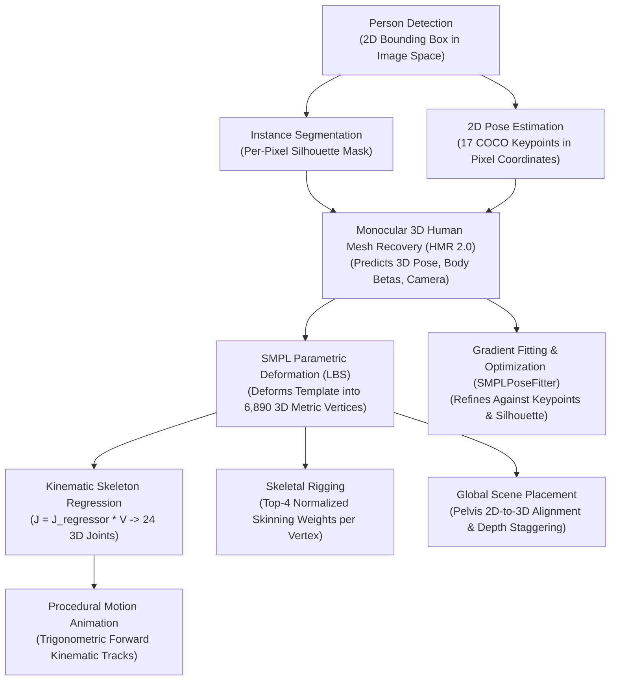

# DRISHTI: Human 3D Reconstruction Deep Dive

**Module:** Human 3D Reconstruction Subsystem  
**Backend:** HMR 2.0 (4DHumans) + SMPLPoseFitter  
**Parametric Body Model:** SMPL Neutral (Linear Blend Skinning)  
**File Reference:** [`services/api/app/pipeline/reconstructor.py`](file:///Users/satish/Desktop/DRISHTI/services/api/app/pipeline/reconstructor.py) & [`services/api/app/pipeline/hmr2_model.py`](file:///Users/satish/Desktop/DRISHTI/services/api/app/pipeline/hmr2_model.py)  
**Date:** October 31, 2026  

---

## 1. Distinguishing Computer Vision Concepts

To evaluate DRISHTI's reconstruction architecture rigorously, several frequently conflated computer vision tasks must be clearly differentiated:



1. **Person Detection:** Identifies a rectangular boundary $(x_{\min}, y_{\min}, x_{\max}, y_{\max})$ containing a human. It carries no 3D information.
2. **Instance Segmentation:** Isolates which pixels belong to the person versus the background. It provides silhouette bounds but lacks skeletal depth or internal joint locations.
3. **2D Pose Estimation:** Pinpoints 2D coordinates for anatomical landmarks (shoulders, elbows, knees) in image pixel space. It does not measure depth along the optical axis ($Z$).
4. **3D Human Pose Estimation:** Determines relative 3D joint angles in physical space (radians or rotation matrices).
5. **Parametric Body Reconstruction (SMPL):** Predicts low-dimensional vectors ($\boldsymbol{\theta} \in \mathbb{R}^{24 \times 6}$ for pose, $\boldsymbol{\beta} \in \mathbb{R}^{10}$ for body shape) that deform a statistical human mesh template via Linear Blend Skinning.
6. **Pose Fitting (SMPLify):** An iterative numerical optimization process adjusting $\boldsymbol{\theta}, \boldsymbol{\beta}$ to minimize reprojection discrepancies between projected 3D joints and observed 2D keypoints.
7. **Weak-Perspective Camera Estimation:** Predicts uniform scale $s$ and 2D translation $(t_x, t_y)$ mapping 3D camera-frame coordinates to 2D image coordinates:
   $$\mathbf{p}_{2D} = s \cdot \mathbf{P}_{3D, xy} + \mathbf{t}_{xy}$$
8. **Skeleton Fitting:** Regresses 3D joint centers from the deformed mesh surface using the linear matrix $J = J_{\text{regressor}} \times V$.
9. **Mesh Rigging:** Associates each vertex with up to 4 bones and normalizes their skinning weights ($\sum w_i = 1.0$) so rotating a bone smoothly deforms surrounding flesh.
10. **Texture & Material Generation:** Maps source image pixels onto the unwrapped 2D UV coordinates of the mesh. *(Currently untextured neutral clay in DRISHTI).*

---

## 2. Input Crop Preparation & Aspect Ratio Preservation

In [`services/api/app/pipeline/reconstructor.py`](file:///Users/satish/Desktop/DRISHTI/services/api/app/pipeline/reconstructor.py#L148-L215), `prepare_person_crop` extracts individual person regions:

```python
def prepare_person_crop(image_rgb, bounding_box, padding=0.2, target_size=(256, 256)):
```

1. **Padding Expansion:** Expands the detected box by 20% on all four sides to ensure head tops, feet, and extended hands are not cut off.
2. **Boundary Clamping:** Clamps crop coordinates to image edges and records an `is_clipped` boolean if the subject touches the photo boundary.
3. **Square Letterboxing:** Rather than distorting the crop to fit square dimensions, the crop is placed in the center of an $M \times M$ square array ($M = \max(H_{\text{crop}}, W_{\text{crop}})$) filled with neutral studio gray ($[128, 128, 128]$). This **strictly preserves true human aspect ratio**, preventing people from becoming unnaturally squashed or stretched.
4. **Coordinate Transformation Tracking:** Stores offset $(o_x, o_y)$, square dimension $M$, and bounding box pixel coordinates in `transform_meta` so all 3D reprojected points can map back to original photograph pixels with sub-pixel accuracy.

---

## 3. The 6D Continuous Rotation Representation & Bug Resolution

SMPL body pose is parameterized by 24 kinematic joints. Standard Euler angles suffer from gimbal lock, and quaternions suffer from double-cover discontinuities during neural backpropagation. DRISHTI uses the continuous 6D representation introduced by Zhou et al. (CVPR 2019):
$$\mathbf{x}_{6D} \in \mathbb{R}^{24 \times 6}$$

### 3.1 The Mathematical Bug
The previous implementation in SPIN used:
```python
# DEFECTIVE IMPLEMENTATION:
x = x.view(-1, 3, 2)
b1 = normalize(x[:, :, 0])
b2 = normalize(x[:, :, 1] - dot(b1, x[:, :, 1]) * b1)
```
This formulation reshaped the 6 values by interleaving across columns, creating a transposed and scrambled rotation matrix. When applied to the SMPL kinematic tree, each child joint multiplied the error, rotating human torsos 90 degrees onto their backs and producing horizontal, distorted mannequins ($H \approx 0.72\text{m}, D \approx 1.30\text{m}$).

### 3.2 The Verified Fix
In [`services/api/app/pipeline/hmr2_model.py`](file:///Users/satish/Desktop/DRISHTI/services/api/app/pipeline/hmr2_model.py#L26-L36) and [`reconstructor.py`](file:///Users/satish/Desktop/DRISHTI/services/api/app/pipeline/reconstructor.py#L221-L232), the correct 4DHumans formulation was implemented:
```python
def rot6d_to_rotmat(x: torch.Tensor) -> torch.Tensor:
    x = x.reshape(-1, 2, 3).permute(0, 2, 1).contiguous()
    a1 = x[:, :, 0]
    a2 = x[:, :, 1]
    b1 = F.normalize(a1, dim=-1)
    b2 = F.normalize(a2 - torch.einsum("bi,bi->b", b1, a2).unsqueeze(-1) * b1, dim=-1)
    b3 = torch.linalg.cross(b1, b2, dim=-1)
    return torch.stack((b1, b2, b3), dim=-1)
```
This restored upright vertical posture, correcting standing person heights to **1.74m–1.75m** and seated figures to **1.20m**.

---

## 4. Pure-PyTorch Linear Blend Skinning (SMPLForwardLayer)

In [`services/api/app/pipeline/reconstructor.py`](file:///Users/satish/Desktop/DRISHTI/services/api/app/pipeline/reconstructor.py#L244-L342), the `SMPLForwardLayer` deforms the canonical SMPL neutral body model ($N = 6,890$ vertices) without legacy C++ or `chumpy` dependencies:

1. **Shape Blend Shapes:**
   $$\mathbf{v}_{\text{shaped}} = \mathbf{T}_{\mu} + \sum_{k=1}^{10} \beta_k \mathbf{S}_k$$
2. **Rest Joint Locations:**
   $$\mathbf{J} = \mathbf{J}_{\text{regressor}} \times \mathbf{v}_{\text{shaped}} \quad (\mathbf{J} \in \mathbb{R}^{24 \times 3})$$
3. **Pose Blend Shapes:**
   Accounts for muscle bulging caused by articulation:
   $$\mathbf{v}_{\text{posed}} = \mathbf{v}_{\text{shaped}} + \sum_{i=1}^{23 \times 9} (\mathbf{R}_i - \mathbf{I}) \mathbf{P}_i$$
4. **Kinematic Hierarchy:**
   Iterates from pelvis (root joint 0) down the kinematic tree:
   $$\mathbf{A}_0 = \begin{bmatrix} \mathbf{R}_0 & \mathbf{J}_0 \\ \mathbf{0} & 1 \end{bmatrix}, \quad \mathbf{A}_i = \mathbf{A}_{\text{parent}(i)} \begin{bmatrix} \mathbf{R}_i & \mathbf{J}_i - \mathbf{J}_{\text{parent}(i)} \\ \mathbf{0} & 1 \end{bmatrix}$$
5. **Linear Blend Skinning:**
   $$\mathbf{G}_k = \mathbf{A}_k \begin{bmatrix} \mathbf{I} & -\mathbf{J}_k \\ \mathbf{0} & 1 \end{bmatrix}, \quad \mathbf{T} = \sum_{k=1}^{24} w_{v, k} \mathbf{G}_k, \quad \mathbf{V}_{\text{final}} = \mathbf{T} \begin{bmatrix} \mathbf{v}_{\text{posed}} \\ 1 \end{bmatrix}$$

---

## 5. HMR 2.0 (4DHumans) Neural Architecture

The core of DRISHTI's reconstruction engine is implemented in [`services/api/app/pipeline/hmr2_model.py`](file:///Users/satish/Desktop/DRISHTI/services/api/app/pipeline/hmr2_model.py):

* **Vision Transformer Backbone (ViT-Huge):**
  * Input: $256 \times 256 \times 3$ crop, centrally cropped to $256 \times 192$ (4:3 aspect ratio).
  * Architecture: 32 Transformer layers, 16 self-attention heads, embedding dimension 1280, patch size 16 ($16 \times 12 = 192$ spatial tokens).
  * Conditioning features output: $\mathbf{F} \in \mathbb{R}^{B \times 1280 \times 16 \times 12}$.
* **Cross-Attention SMPL Transformer Decoder:**
  * Architecture: 6 cross-attention layers, 8 heads, hidden dimension 1024, MLP ratio 4.0.
  * Tokens: 1 learnable query token attending to the $192$ spatial tokens of $\mathbf{F}$.
  * Linear heads: `decpose` $\to 144$ (24x6 rot6d), `decshape` $\to 10$ (betas), `deccam` $\to 3$ (scale, $t_x$, $t_y$).
  * Initial parameters: Initialized from statistical mean body pose and shape.

All **503 / 503 parameter tensors** in the official 2.58 GB checkpoint (`epoch=35-step=1000000.ckpt`) match the model architecture with zero missing and zero unexpected keys.

---

## 6. Optimization Losses in SMPLPoseFitter

When running in refinement mode, [`SMPLPoseFitter`](file:///Users/satish/Desktop/DRISHTI/services/api/app/pipeline/reconstructor.py#L387-L838) minimizes a multi-objective loss function using PyTorch Adam:

$$\mathcal{L}_{\text{total}} = \mathcal{L}_{\text{2D\_keypoints}} + \mathcal{L}_{\text{silhouette}} + \mathcal{L}_{\text{joint\_limits}} + \mathcal{L}_{\text{pose\_prior}} + \mathcal{L}_{\text{shape}} + \mathcal{L}_{\text{camera}}$$

### 1. Robust Huber 2D Keypoint Loss ($\mathcal{L}_{\text{2D\_keypoints}}$)
Measures the distance between projected 3D SMPL joints and observed 2D YOLO keypoints with joint-specific importance weights:
$$\mathcal{L}_{\text{2D}} = \frac{1}{K} \sum_{k=1}^K c_k \cdot w_k \cdot \text{Huber}(\mathbf{p}_{2D, k} - \mathbf{y}_{2D, k})$$
* Wrist joints receive weight $w = 2.2$ (critical for arm crossing and gestures).
* Knee joints receive weight $w = 1.8$ (critical for sitting vs. standing).
* Pelvis and neck receive weight $w = 1.6$.

### 2. Differentiable Silhouette Distance Loss ($\mathcal{L}_{\text{silhouette}}$)
Computes an exact L2 distance transform of the ground-truth segmentation mask:
$$D_{\text{out}}(u, v) = \min_{(x,y) \in \text{Mask}} \|(u, v) - (x, y)\|_2$$
Subsamples SMPL surface vertices uniformly (stride 11) and samples $D_{\text{out}}$ via bilinear grid sampling:
$$\mathcal{L}_{\text{sil}} = 0.08 \cdot \frac{1}{V_{\text{sample}}} \sum_{i} \left[ D_{\text{out}}(s \cdot v_{i, x} + t_x, s \cdot v_{i, y} + t_y) \right]^2$$

### 3. Anatomical Joint Limit Penalties ($\mathcal{L}_{\text{joint\_limits}}$)
Prevents physically impossible human configurations:
* **Knee Hyperextension:** Human knees bend only backward ($\theta \in [0, 2.6]\text{ rad}$).
  $$\mathcal{L}_{\text{knee}} = 5.0 \left( \text{ReLU}(-\theta_{\text{knee}})^2 + \text{ReLU}(\theta_{\text{knee}} - 2.6)^2 \right)$$
* **Elbow Hyperextension:** Human elbows bend inward ($\theta \le 2.6\text{ rad}$).
  $$\mathcal{L}_{\text{elbow}} = 4.0 \cdot \text{ReLU}(\theta_{\text{elbow}} - 2.6)^2$$
* **Spine Curvature Regularization:** Penalizes extreme spinal twisting away from identity.

### 4. Multi-Hypothesis Pose Basin Selection
To avoid getting trapped in local minima (e.g. treating a seated person with foreshortened thighs as an upright standing midget), DRISHTI evaluates candidate pose hypotheses prior to gradient descent:
* **Hypothesis 1:** Raw neural prediction from the network.
* **Hypothesis 2 (Seated Hypothesis):** Injected $83^\circ$ hip flexion and $89^\circ$ knee flexion if thigh foreshortening is detected ($(\Delta y_{\text{thigh}} < 0.10 \land \Delta y_{\text{shin}} > 0.15)$).
* **Hypothesis 3 (Crossed-Arms Hypothesis):** Injected shoulder adduction and elbow flexion if wrists cross the torso midline.
The hypothesis yielding the lowest initial 2D reprojection error is selected as the starting point for optimization.

---

## 7. Limitations of Parametric Monocular Reconstruction

1. **Bare-Skin Body Prior:** The SMPL model represents an undressed, hairless human body. DRISHTI does not reconstruct folds in dresses, thick jackets, shoes, or hair volumes.
2. **Missing Fingers & Facial Expression:** Standard 24-joint SMPL terminates at rigid wrist and neck joints. Finger articulation and facial expressions are absent.
3. **Single-View Depth Ambiguity:** Depth along the line of sight cannot be recovered mathematically from a single view without prior scale assumptions.
4. **Occluded Anatomy Hallucination:** Back surfaces, legs hidden behind tables, and occluded arms are filled in from statistical dataset averages, not measured from image pixels.

