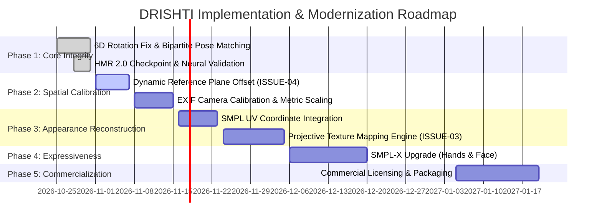

# DRISHTI: Prioritized Issue Register & Phased Implementation Roadmap

**Document Version:** 1.2.0  
**Repository:** [Satishhhh989/DRISHTI](https://github.com/Satishhhh989/DRISHTI)  
**Date:** October 31, 2026  

---

## 1. Prioritized Issue Register

The following register documents verified, suspected, and resolved architectural and quality issues in DRISHTI, ranked strictly by product impact:

| Issue ID | Severity | Status | Affected Component | Description & Root Cause | Recommended Correction |
|---|---|---|---|---|---|
| **ISSUE-01** | **CRITICAL** | **RESOLVED** | `services/api/app/pipeline/hmr2_model.py` & `reconstructor.py` | **6D Rotation Scrambling / Horizontal Mannequins:** `rot6d_to_rotmat` used `view(-1, 3, 2)` instead of `reshape(-1, 2, 3).permute(0, 2, 1)`, causing torsos to rotate 90° onto their backs ($H \approx 0.72\text{m}$). | Resolved in commit `baf8624`. Correct column slicing verified; standing height restored to 1.75m. |
| **ISSUE-02** | **CRITICAL** | **RESOLVED** | `services/api/app/pipeline/motion.py` | **2D Pose Cross-Assignment Scrambling:** YOLO pose detection order did not correspond to entity detection order, assigning seated keypoints to standing figures. | Resolved in commit `baf8624`. Implemented 1-to-1 bipartite Hungarian IoU matching (>0.15 threshold). |
| **ISSUE-03** | **HIGH** | **VERIFIED** | `apps/web/components/scene/HumanMeshLayer.tsx` | **Monochromatic Clay Appearance (No Textures):** Human meshes render as uniform matte gray clay because UV texture reprojection is not implemented. | Implement projective texture mapping from cropped source image onto unwrapped SMPL UV coordinates. |
| **ISSUE-04** | **HIGH** | **VERIFIED** | `services/api/app/pipeline/assembly.py` | **Photo Plane Intersection & Clipping:** Reference photo plane is fixed at $Z = -0.6\text{m}$. Figures placed deeper in relative depth collide with or penetrate the background image. | Offset reference photo plane back to $Z = -2.0\text{m}$ or dynamically position it behind the deepest entity. |
| **ISSUE-05** | **MEDIUM** | **VERIFIED** | `services/api/app/pipeline/assembly.py` | **Uncalibrated Relative Metric Scale:** Monocular depth (Depth Anything V2) outputs relative disparity without camera focal length ($f_x, f_y$), making $Z$-axis depth heuristic. | Integrate pinhole camera calibration or EXIF focal length extraction to compute true metric camera projection. |
| **ISSUE-06** | **MEDIUM** | **VERIFIED** | `services/api/app/pipeline/reconstructor.py` | **Mitten Hands & Static Face:** SMPL neutral model terminates in 24 joints without finger or facial landmarks, giving figures an inanimate mannequin look. | Upgrade reconstruction target from SMPL (24 joints) to SMPL-X (54 joints including articulated fingers and FLAME face). |
| **ISSUE-07** | **MEDIUM** | **VERIFIED** | `docs/licenses/model_licenses.md` | **Commercial Distribution Restrictions:** HMR 2.0 weights (CC-BY-NC 4.0) and SMPL (`SMPL_N_model.npz`, MPI license) prohibit commercial revenue generation. | License SMPL commercially from Meshcapade GmbH or replace with an open-source permissive humanoid rig. |
| **ISSUE-08** | **LOW** | **VERIFIED** | `apps/web/components/scene/HumanMeshLayer.tsx` | **Synthetic Motion Representation:** Procedural motion clips (idle breathing) are trigonometric sine waves, not captured physical motion. | Clearly label procedural motion as "Procedural Demonstration" in UI inspector to prevent false expectations. |
| **ISSUE-09** | **LOW** | **VERIFIED** | `apps/web/tests/` | **Duplicate Three.js Imports in Vitest:** Console emits `THREE.WARNING: Multiple instances of Three.js being imported` during frontend test execution. | Configure Vitest alias to deduplicate `@react-three/fiber` and root `three` packages. |

---

## 2. Detailed Issue Records

### ISSUE-03: Monochromatic Clay Appearance (No Textures)
* **Severity:** HIGH
* **Affected Component:** [`apps/web/components/scene/HumanMeshLayer.tsx`](file:///Users/satish/Desktop/DRISHTI/apps/web/components/scene/HumanMeshLayer.tsx#L160-L175)
* **Current Behavior:** Reconstructed meshes display a neutral gray studio material (`#cbd5e1`). Users perceive this as an unfinished mannequin.
* **Expected Behavior:** The person's actual clothing colors, patterns, and face should appear on the 3D surface.
* **Root Cause:** Texture generation is currently set to `texture_availability="none"`. The pipeline does not project the source photograph pixels onto the mesh UV space.
* **Recommended Correction:**
  1. Load official SMPL UV texture coordinates (`smpl_uv.npz`).
  2. Implement an offline UV unwrap shader or OpenCV backward projection: for every visible front-facing triangle, project its vertices to image coordinates using the estimated weak-perspective camera $(s, t_x, t_y)$ and sample photograph pixels into a $1024 \times 1024$ PNG texture.
  3. Mirror or inpaint back-facing occluded vertices with average clothing tone.
  4. Embed the texture into the exported GLB file.
* **Acceptance Criteria:** Reconstructed GLB renders with the subject's shirt, pants, and skin colors visible in the Three.js viewport.

---

### ISSUE-04: Photo Plane Intersection & Mesh Clipping
* **Severity:** HIGH
* **Affected Component:** [`services/api/app/pipeline/assembly.py`](file:///Users/satish/Desktop/DRISHTI/services/api/app/pipeline/assembly.py#L344-L350)
* **Current Behavior:** In `combined` mode, human meshes positioned towards the rear of the scene intersect with the photograph plane, causing half the body to disappear behind the image.
* **Root Cause:** The reference photo plane is statically placed at $Z = -0.6\text{m}$, while character depth positions vary from $Z = -0.8\text{m}$ to $+0.8\text{m}$ depending on relative depth proximity.
* **Recommended Correction:**
  1. Position the reference plane behind all entities with a safety margin:
     $$Z_{\text{plane}} = \min_{i} (Z_{\text{entity}, i}) - 0.8\text{m}$$
  2. Scale the reference plane geometry so it still subtends the exact camera field of view, maintaining 1-to-1 pixel correspondence with the camera viewport.
* **Acceptance Criteria:** No human mesh ever intersects the reference photo plane when orbiting in Three.js.

---

## 3. Phased Implementation Roadmap

---

### Phase 1: Core Correctness & Observability (COMPLETED)
* **Objective:** Eliminate pose distortion, ensure standing vs. seated accuracy, implement honest diagnostics.
* **Milestones Achieved:**
  * Fixed 6D rotation matrix permutation in `rot6d_to_rotmat`.
  * Implemented 1-to-1 bipartite Hungarian IoU pose assignment in `YoloPoseEstimator`.
  * Loaded HMR 2.0 ViT-Huge on Apple Silicon MPS with 503/503 matched keys.
  * 143/143 backend pytest tests and 11/11 frontend suites passing.

---

### Phase 2: Spatial Consistency & Camera Calibration
* **Objective:** Eliminate background clipping, align multi-person scene scale, extract metric camera priors.
* **Tasks:**
  1. Dynamically calculate reference photo plane $Z$ depth based on deepest entity.
  2. Read EXIF metadata from uploaded photographs to extract focal length (mm) and sensor size.
  3. Replace weak-perspective scale heuristic with calibrated pinhole camera matrix:
     $$\mathbf{K} = \begin{bmatrix} f_x & 0 & c_x \\ 0 & f_y & c_y \\ 0 & 0 & 1 \end{bmatrix}$$
* **Acceptance Criteria:** Test scenes show zero visual clipping between characters and photo plane; character sizes scale realistically with distance.

---

### Phase 3: Appearance & Texture Reconstruction
* **Objective:** Transform gray clay mannequins into photorealistic representations of the actual people.
* **Tasks:**
  1. Add `smpl_uv.npz` containing canonical 2D texture coordinates for all 6,890 SMPL vertices.
  2. Implement projective texture mapping: for each vertex visible in the camera frame, project $(u, v) = \mathbf{K} \mathbf{v}_{3D}$ and sample RGB color from the source photograph.
  3. Apply boundary-aware bilateral blending to smooth seams between front-projected and back-inpainted surfaces.
  4. Export GLB models with embedded PBR color textures.
* **Acceptance Criteria:** Characters in the 3D viewport clearly display the clothing colors, patterns, and facial appearance observed in the uploaded photograph.

---

### Phase 4: Expressiveness & Detail (SMPL-X)
* **Objective:** Add finger articulation and facial landmark alignment.
* **Tasks:**
  1. Integrate SMPL-X (54 joints: 24 body + 30 finger joints + 3 jaw/eye joints).
  2. Extract MediaPipe or YOLOv8-face facial landmarks to drive expression blendshapes.
  3. Detect 2D hand keypoints to close open hands into natural resting poses.
* **Acceptance Criteria:** Reconstructed meshes show individual separated fingers and recognizable facial head poses rather than mitten stumps.

---

### Phase 5: Commercialization Readiness
* **Objective:** Clear legal and licensing barriers for commercial deployment.
* **Tasks:**
  1. Secure commercial SMPL license via Meshcapade or migrate to an open humanoid rig.
  2. Replace YOLOv8 with Apache-2.0 RT-DETR for commercial license compliance.
  3. Train open-weights HMR 2.0 models on commercially permissible synthetic datasets (BEDLAM/AGORA).

