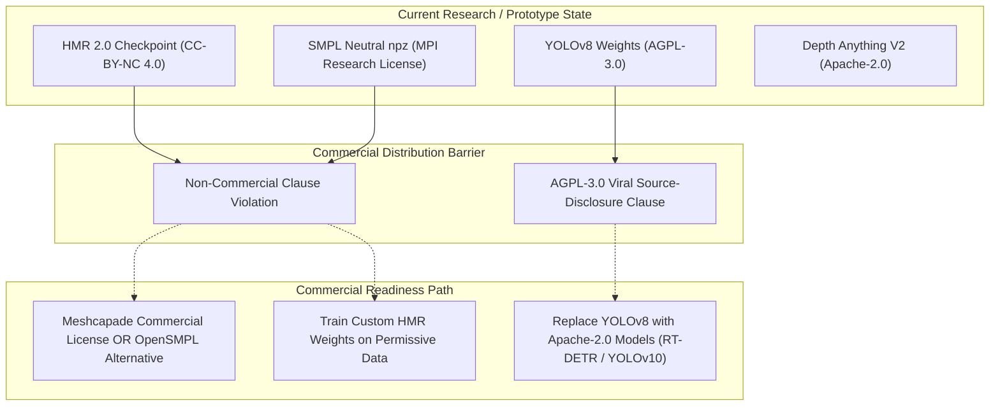

# DRISHTI: AI Model, Checkpoint & Licensing Audit

**Document Version:** 1.1.0  
**Repository:** [Satishhhh989/DRISHTI](https://github.com/Satishhhh989/DRISHTI)  
**Classification:** Legal, Compliance & Model Inventory Audit  
**Date:** October 31, 2026  

---

## 1. Verified Model Asset Inventory

Every model asset referenced or executed by DRISHTI was inspected on local storage:

| Model Key | Local Checkpoint Path | Verified File Size | Availability on Disk | Primary / Fallback | Architecture |
|---|---|---|---|---|---|
| `hmr2` | `data/models/hmr2/epoch=35-step=1000000.ckpt` | **2,709,521,501 bytes** (~2.58 GB) | **Present & Verified** | **Active Primary** | ViT-Huge (32 layers) + SMPL Transformer Decoder (6 layers) |
| `hmr2-config` | `data/models/hmr2/model_config.yaml` | 3,083 bytes | **Present & Verified** | **Active Primary** | 4DHumans Hydra configuration file |
| `smpl-neutral` | `data/models/human_reconstruction/SMPL_N_model.npz` | 38,623,354 bytes (~38.6 MB) | **Present & Verified** | **Active Core** | SMPL neutral body model template (6,890 verts, 24 joints) |
| `smpl-mean` | `data/models/human_reconstruction/smpl_mean_params.npz` | 1,228 bytes | **Present & Verified** | **Active Core** | Statistical mean pose, shape, and camera vectors |
| `yolov8m-seg` | `data/models/yolov8m-seg.pt` | 54,921,020 bytes (~52.4 MB) | **Present & Verified** | **Active Primary** | YOLOv8 Medium Detection + Instance Segmentation Head |
| `yolov8m-pose` | `data/models/yolov8m-pose.pt` | 53,266,977 bytes (~50.8 MB) | **Present & Verified** | **Active Primary** | YOLOv8 Medium 2D Human Pose Estimation (17 COCO keypoints) |
| `depth-anything-v2` | `data/models/depth-anything-v2-small/model.safetensors` | 99,173,660 bytes (~99.2 MB) | **Present & Verified** | **Active Primary** | DPT architecture with ViT-Small backbone (Depth Anything V2) |
| `spin-reconstruction`| `data/models/human_reconstruction/spin_model_checkpoint.pth.tar` | 108,181,518 bytes (~108.2 MB)| **Present & Verified** | **Standby Fallback** | ResNet-50 + Iterative 6D Parameter Regressor (SPIN) |
| `yolov8n-seg` | `data/models/yolov8n-seg.pt` | 7,071,756 bytes (~6.7 MB) | **Present & Verified** | Standby Fallback | YOLOv8 Nano Instance Segmentation |
| `yolov8n-pose` | `data/models/yolov8n-pose.pt` | 6,832,633 bytes (~6.5 MB) | **Present & Verified** | Standby Fallback | YOLOv8 Nano 2D Human Pose Estimation |

---

## 2. Model Licensing & Provenance Breakdown

### 2.1 HMR 2.0 / 4DHumans
* **Paper / Upstream:** Goel et al., *"Reconstructing Humans in 3D: A 4D-Humans Foundation Model"*, CVPR 2023.
* **Upstream Code Repository:** [shubham-goel/4D-Humans](https://github.com/shubham-goel/4D-Humans) (MIT License).
* **Pretrained Weights:** Hosted on Hugging Face at `camenduru/4D-Humans`.
* **Weights License:** **Creative Commons Attribution-NonCommercial 4.0 International (CC-BY-NC 4.0)**.
* **Commercial Status:** **RESTRICTED**. The pretrained checkpoint cannot be utilized in commercial revenue-generating products without explicit written permission from the authors or training custom weights on commercial-permissive data.

### 2.2 SMPL (Skinned Multi-Person Linear Model)
* **Creator:** Max Planck Institute for Intelligent Systems (MPI-IS), Loper et al., SIGGRAPH Asia 2015.
* **Assets in DRISHTI:** `SMPL_N_model.npz` (contains `v_template`, `shapedirs`, `posedirs`, `J_regressor`, `weights`, `kintree_table`).
* **License:** **SMPL Non-Commercial Research License Agreement**.
* **Commercial Status:** **STRICTLY RESTRICTED**. Commercial use requires a commercial license from [Meshcapade GmbH](https://meshcapade.com), the official commercial licensing entity for SMPL/SMPL-X.

### 2.3 Ultralytics YOLOv8 (Segmentation & Pose)
* **Creator:** Ultralytics Inc.
* **Assets in DRISHTI:** `yolov8m-seg.pt`, `yolov8m-pose.pt`, `yolov8n-seg.pt`, `yolov8n-pose.pt`.
* **License:** **GNU Affero General Public License v3.0 (AGPL-3.0)**.
* **Commercial Status:** **CONDITIONAL**. Under AGPL-3.0, any software interacting over a network with an AGPL binary must open-source its complete source code under AGPL-3.0. Alternatively, Ultralytics sells proprietary Enterprise commercial licenses.

### 2.4 Depth Anything V2 Small
* **Creator:** ByteDance / TikTok / Yang et al., 2024.
* **Assets in DRISHTI:** `depth-anything-v2-small/model.safetensors`.
* **License:** **Apache License 2.0**.
* **Commercial Status:** **PERMISSIVE**. Permitted for commercial use, modification, and distribution without copyleft restrictions.

---

## 3. Commercialization Audit & Legal Compliance Assessment

### 3.1 Can DRISHTI Be Sold or Commercialized Today?
**NO.** The current implementation includes components under **CC-BY-NC 4.0** (HMR 2.0 weights) and **SMPL Non-Commercial License** (`SMPL_N_model.npz`). Distributing or hosting this software as a paid service violates upstream licensing agreements.

### 3.2 What Is Required for Full Commercial Distribution?
To distribute DRISHTI commercially as a closed-source SaaS or on-premise product:

1. **SMPL Resolution:**
   * Option A (Recommended): Obtain an official commercial license from **Meshcapade GmbH**.
   * Option B: Replace SMPL with an open, non-proprietary rigged human base mesh (e.g. MakeHuman / MP-Mesh) and train skinning weights natively.
2. **HMR 2.0 Weights Resolution:**
   * Train an open-weights HMR 2.0 model exclusively on commercially cleared datasets (e.g., synthetic datasets such as BEDLAM, AGORA, or SynBody) or negotiate terms with UC Berkeley.
3. **YOLOv8 AGPL Resolution:**
   * Option A: Purchase an Enterprise License from **Ultralytics Inc.**
   * Option B: Replace YOLOv8 with **RT-DETR (Apache-2.0)** for detection and **ViTPose (Apache-2.0)** for keypoints.

---

## 4. Unresolved Compliance Questions

1. **Training Data Copyright:** 4DHumans was trained on in-the-wild datasets (COCO, MPII, Human3.6M, InstaVariety). Some downstream commercial jurisdictions (e.g. EU AI Act) require data transparency disclosures regarding whether web-scraped images contain biometric identifiers.
2. **Derivative Works on Weights:** When `SMPLPoseFitter` optimizes SMPL parameters against an image crop, is the resulting GLB mesh a derivative work of SMPL? (Meshcapade holds that 3D meshes derived from the SMPL template topology inherit SMPL licensing restrictions).

