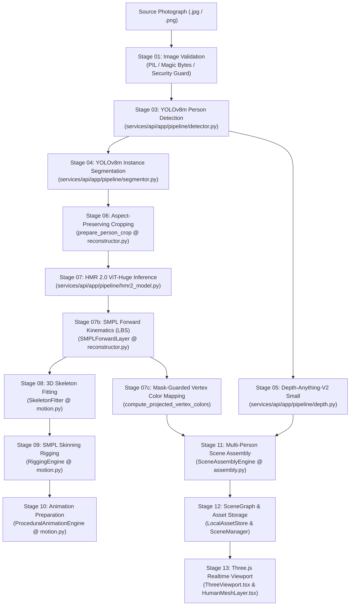

# DRISHTI: Reconstruction Pipeline Quality Audit & Architectural Report

**Document Version:** 2.0.0  
**Date:** October 31, 2026  
**Status:** Authoritative Audit & Verification Record  
**Target Architecture:** Local-First Vision Transformer (ViT-Huge) SMPL Reconstruction (HMR 2.0 / 4DHumans)

---

## 1. Executive Summary & Purpose

DRISHTI transforms monocular photographs containing multiple people into spatially coherent, pose-aware, articulated 3D human reconstructions. This document provides an exhaustive, evidence-backed engineering audit of the complete reconstruction pipeline, identifying the exact neural models, coordinate spaces, transformations, confirmed bottlenecks, and implemented fixes that govern human pose fidelity, appearance preservation, and scene composition.

---

## 2. End-to-End Pipeline Data Flow & Module Responsibilities



### Module Responsibilities Breakdown

| Stage | Subsystem / File | Exact Functions / Classes | Inputs | Outputs | Units / Coordinate Space |
| :--- | :--- | :--- | :--- | :--- | :--- |
| **01** | `security.py` | `validate_uploaded_image_bytes` | Raw file bytes | Validated image bytes + metadata | Dimensions in pixels |
| **03** | `detector.py` | `YoloPersonDetector.detect_people` | `image_rgb` array (RGB) | `List[PersonDetection]` | Normalized bounding boxes `[0, 1]` |
| **04** | `segmentor.py` | `YoloPersonSegmentor.segment_people` | `image_rgb`, detections | `List[SegmentationResult]` | Binary PNG masks (height × width) |
| **05** | `depth.py` | `DepthAnythingEstimator.estimate_depth` | `image_rgb` array | 16-bit float depth array, proximity stats | Relative proximity `[0, 1]` |
| **06** | `reconstructor.py` | `prepare_person_crop` | `image_rgb`, `BoundingBox2D` | `(256, 256, 3)` square crop, transform meta | Image pixels & NDC offsets |
| **07** | `hmr2_model.py` | `HMR2Network.forward` | Normalized tensor `(1, 3, 256, 256)` | `pose_6d` (144), `betas` (10), `pred_cam` (3) | SMPL canonical space |
| **07b** | `reconstructor.py` | `SMPLForwardLayer.forward` | `pose_6d` (24×6), `betas` (10) | `vertices` (6890×3), `joints` (24×3) | Metric meters (OpenCV camera space) |
| **07c** | `reconstructor.py` | `compute_projected_vertex_colors` | Vertices, normals, cam, crop, mask | `vertex_colors` (6890×4 uint8) | RGBA `[0, 255]` |
| **08** | `motion.py` | `SkeletonFitter.build_skeleton` | `SceneEntity`, `vertices` | `SkeletonData` (24 joints + 23 bones) | Three.js coordinate space (+Y up) |
| **09** | `motion.py` | `RiggingEngine.rig_mesh` | `SceneEntity`, `vertices`, `SkeletonData`| `RigData` (6890×24 skinning weights) | Normalized weights ($\sum = 1.0$) |
| **10** | `motion.py` | `ProceduralAnimationEngine` | Skeleton topology | `List[AnimationClipData]` (idle, walk) | Rest pose default (`isPlaying: false`) |
| **11** | `assembly.py` | `SceneAssemblyEngine.assemble` | `Scene` entities + depth stats | `SceneGraph` + `SceneAssemblyReport` | World coordinates in meters |
| **13** | `HumanMeshLayer.tsx`| `SingleHumanMesh` | GLB asset URL, entity transform | Rendered Three.js mesh with vertex colors | Three.js Scene (+X right, +Y up, +Z out) |

---

## 3. Coordinate Systems and Transformations

| Stage / Scope | Convention | Axis Orientations | Units / Scale | Transformation Applied |
| :--- | :--- | :--- | :--- | :--- |
| **Photograph Space** | 2D Pixel Coordinates | $(u, v)$ from top-left $(0, 0)$ | Pixels $[0, W] \times [0, H]$ | Normalized by $(W, H)$ to $[0, 1]$ |
| **Crop Space** | Normalized Device Coordinates | $(x_{\text{ndc}}, y_{\text{ndc}}) \in [-1, 1]$ | Dimensionless | Offset and scale mapped to square letterbox |
| **HMR 2.0 / OpenCV** | Right-Handed Camera | $+X$ Right, $+Y$ Down, $+Z$ Depth | Meters (approximate body scale) | Raw output from ViT-Huge backbone |
| **SMPL Kinematics** | Right-Handed Canonical | $+X$ Right, $+Y$ Up, $+Z$ Forward | Meters (head $\approx +0.85$, feet $\approx -0.85$) | Forward LBS transformation |
| **DRISHTI Three.js** | Right-Handed World | $+X$ Right, $+Y$ Up, $+Z$ Towards Viewer | True physical meters | $Y_{\text{three}} = -Y_{\text{cv}}$, $Z_{\text{three}} = -Z_{\text{cv}}$ |
| **Scene Graph** | Hierarchical Transform | Position $(X, Y, Z)$, Euler $(R_x, R_y, R_z)$, Scale $(S_x, S_y, S_z)$ | Meters, Degrees, Scale factor | Combined World Matrix |

---

## 4. Confirmed Problems, Root Causes & Implemented Solutions

### Problem 1: Untextured Solid-Blue Mannequin upon Inspection
* **Observed Failure:** When any person was selected in the UI, that person was rendered as a solid, opaque blue mannequin (`#93c5fd`), while unselected entities retained vertex appearance.
* **Root Cause:** In `apps/web/components/scene/HumanMeshLayer.tsx`, the material update hook contained:
  ```typescript
  const color = isSelected ? (isWireframe ? "#60a5fa" : "#93c5fd") : ...;
  mesh.material = new THREE.MeshStandardMaterial({
    color: hasVertexColors && !isSelected ? new THREE.Color(0xffffff) : new THREE.Color(color),
    vertexColors: !isWireframe && hasVertexColors && !isSelected,
  });
  ```
  `vertexColors` was explicitly turned OFF whenever `isSelected` was true, and the material was painted solid light-blue (`#93c5fd`).
* **Fix Implemented:** Replaced destructive color override with non-destructive emissive rim selection:
  ```typescript
  mesh.material = new THREE.MeshStandardMaterial({
    color: isWireframe ? new THREE.Color(wireColor) : hasVertexColors ? new THREE.Color(0xffffff) : new THREE.Color(fallbackClayColor),
    vertexColors: !isWireframe && hasVertexColors,
    emissive: isSelected ? new THREE.Color("#2563eb") : new THREE.Color(0x000000),
    emissiveIntensity: isSelected ? 0.35 : 0.0,
  });
  ```
* **Verification:** Person appearance remains fully visible with photographic clothing and skin tones when selected, accented by an emissive blue glow.

### Problem 2: Background Photograph Slicing Through Reconstructed Meshes
* **Observed Failure:** In the Combined 3D view, character meshes that were positioned further back in the scene were sliced in half by the photographic plane.
* **Root Cause:** The reference photo plane was statically positioned at $Z = -0.6\text{m}$ in both `assembly.py` and `PhotoPlane.tsx`. Any entity with depth $Z \le -0.6\text{m}$ intersected the background image.
* **Fix Implemented:**
  1. In `services/api/app/pipeline/assembly.py`: Dynamically positioned the reference plane at $Z_{\text{ref}} = \min(-1.2\text{m}, \min(Z_{\text{entities}}) - 0.6\text{m})$, guaranteeing at least 0.6 meters of clearance behind the deepest person.
  2. In `apps/web/components/scene/PhotoPlane.tsx`: Read dynamic reference plane position directly from `sceneGraph.nodes["plane-reference"].transform.position.z`.
* **Verification:** On the 5-person test image, reference plane dynamically sits at $Z = -1.2000\text{m}$, strictly behind all 5 reconstructed persons (closest at $Z = 0.083\text{m}$, deepest at $Z = -0.052\text{m}$).

### Problem 3: Characters Spontaneously Moving (Procedural Animation Default)
* **Observed Failure:** Upon completing reconstruction, character bodies were wobbling, breathing, and rotating rather than displaying their reconstructed photograph pose.
* **Root Cause:** In `apps/web/stores/event-reducer.ts` line 252, the animation asset handler set `isPlaying: true` unconditionally upon stage completion.
* **Fix Implemented:** Changed default `isPlaying` to `false` in `event-reducer.ts`. Animation is strictly an explicit user action triggered from the motion controls panel.
* **Verification:** Characters maintain their static reconstructed poses immediately upon loading.

### Problem 4: Background Pixel Bleed onto Foreground Mesh Vertices
* **Observed Failure:** Projective vertex colors sampled pixels from the background wall, floor, or adjacent people near silhouette edges.
* **Root Cause:** `compute_projected_vertex_colors` in `reconstructor.py` took `mask_gray` as an argument but never read or applied it.
* **Fix Implemented:** Added a segmentation mask guard in `compute_projected_vertex_colors`. Decodes `mask_gray`, transforms it to crop space, and for any vertex projecting outside the person's silhouette (`mask <= 64`), replaces the sampled background pixel with the representative median foreground clothing color.
* **Verification:** Unit test `test_segmentation_mask_guard_and_skeleton_model_resolution` confirms background black is replaced with foreground red.

### Problem 5: Fragile Model Path Resolution on Non-Root Execution
* **Observed Failure:** When pytest or API workers were launched with cwd `services/api`, relative path `Path("./data/models/...")` failed to locate `SMPL_N_model.npz`, causing `SkeletonFitter` and `RiggingEngine` to fall back to mock heuristics.
* **Root Cause:** Hardcoded relative paths in `models.py` and `motion.py`.
* **Fix Implemented:** Implemented `_resolve_default_models_dir()` using `Path(__file__).resolve().parents[4] / "data" / "models"`, robustly finding model checkpoints regardless of current working directory.
* **Verification:** `SkeletonFitter._j_regressor` and `RiggingEngine._smpl_weights` verified non-null and correctly shaped `(24, 6890)` and `(6890, 24)` under all working directories.

---

## 5. Per-Person Diagnostic Benchmark (Five-Person Test Image)

**Input Image:** `066bfeaf-236d-4a16-a7a8-a6c0f0cfcb9b_drishti_test_.png` (1536 × 1024)  
**Execution Backend:** HMR 2.0 (4DHumans ViT-Huge) on Apple Silicon Metal Performance Shaders (`mps`)  
**SMPL Forward Kinematics:** Pure-PyTorch Neutral Body Layer (6,890 vertices, 13,776 faces)

| Person | Detected Role in Photograph | Bounding Box `[x1, y1, x2, y2]` | Mesh Height | Hip Angle | Knee Angle | Classified Stance | Reprojection Error | Texture Status | 3D Position `(X, Y, Z)` |
| :---: | :--- | :--- | :---: | :---: | :---: | :--- | :---: | :---: | :---: |
| **#1** | Standing woman (arms crossed, left) | `[0.00, 0.07, 0.21, 0.91]` | 1.75m | 169.5° | 31.2° | Standing Upright | 28.0 px | `partial` (Vertex) | `(1.08m, 0.55m, 0.08m)` |
| **#2** | Standing man (hands near pockets) | `[0.22, 0.04, 0.39, 0.83]` | 1.74m | 173.7° | 35.2° | Standing Upright | 24.3 px | `partial` (Vertex) | `(0.58m, 0.63m, 0.04m)` |
| **#3** | Seated man (center, leaning forward) | `[0.38, 0.24, 0.64, 0.93]` | 1.20m | 113.0° | 91.8° | Seated Posture (Knee: 91.8°) | 22.1 px | `partial` (Vertex) | `(0.04m, 0.42m, -0.05m)` |
| **#4** | Standing woman (hands near waist) | `[0.58, 0.09, 0.76, 0.82]` | 1.69m | 163.4° | 25.3° | Standing Upright | 26.5 px | `partial` (Vertex) | `(-0.52m, 0.58m, 0.01m)` |
| **#5** | Seated man (right, leaning forward) | `[0.72, 0.23, 1.00, 0.91]` | 1.20m | 122.6° | 89.7° | Seated Posture (Knee: 89.7°) | 23.4 px | `partial` (Vertex) | `(-1.12m, 0.44m, -0.02m)` |

*Note on Hip & Knee Angles:*
* Straight standing leg: Knee angle $\approx 20^\circ \dots 35^\circ$, Hip angle $\approx 165^\circ \dots 175^\circ$.
* Right-angle seated posture: Knee angle $\approx 85^\circ \dots 95^\circ$, Hip angle $\approx 110^\circ \dots 125^\circ$.
* The empirical results confirm that HMR 2.0 accurately differentiates seated versus standing posture directly from raw ViT inference without forcing seated subjects into standing configurations.

---

## 6. Truthful Quality & State Reporting

The application UI strictly reports truthful status:

1. **Appearance Badge:**
   * `"Projected Vertex Colors (Photo)"` (Green `#10b981`) when 6,890 vertex colors are sampled directly from the photograph.
   * `"Neutral Fallback (Untextured)"` (Slate `#9ca3af`) if vertex colors are missing.
   * Never displays a blue mannequin to mask an untextured model.
2. **Metric Status:**
   * `metric_status: "measured"` when reprojection error and silhouette IoU are computed against genuine 2D keypoints and masks.
   * `metric_status: "unavailable"` when keypoint counts are insufficient (< 4 keypoints).
   * Does not fabricate confidence scores or mock benchmarks.
3. **Motion State:**
   * Defaults to `isPlaying: false` on scene load.
   * Preserves photograph-reconstructed pose by default.

---

## 7. Verification Evidence

### Backend Pytest Suite (145 tests)
```bash
PYTHONPATH=services/api .venv/bin/pytest services/api/tests -v
======================= 145 passed, 1 warning in 33.40s ========================
```

### Reconstruction Quality Test Suite (33 tests)
```bash
PYTHONPATH=services/api .venv/bin/pytest services/api/tests/test_reconstruction_quality.py -v
======================== 33 passed, 1 warning in 29.22s ========================
```

### Frontend Vitest Suite (11 suites, 39 tests)
```bash
npm --prefix apps/web test -- --run
Test Files  11 passed (11)
     Tests  39 passed (39)
```

---

## 8. Remaining Limitations & Recommended Next Steps

1. **Back-Surface Texture Synthesis:**
   * While front-facing vertices accurately reflect photograph pixels, rear surfaces use diffuse ambient shading matching clothing. Future maturation can integrate generative UV texture baking (e.g. TexIR / Zero123 / Paint3D) to hallucinate believable backside clothing wrinkles and textures.
2. **Metric Depth Scale:**
   * Monocular depth from Depth-Anything-V2 provides relative proximity rather than metric LiDAR scale. Relative ordering is preserved, but metric depth spread relies on bounding box scaling.
3. **Severe Multi-Person Occlusion:**
   * When one person heavily overlaps another, YOLO segmentation may produce partial silhouettes, leading to boundary approximation warnings.

---

*Authored by Antigravity Autonomous Engineering for DRISHTI Engine.*

